## 🛠️ Tech stack

  
   
  

<b>🧠 AI / ML toolbox</b> (click to expand)

 

| Area               | Tools & topics                                                             |
| ------------------ | -------------------------------------------------------------------------- |
| **LLMs & GenAI**   | LangGraph · llama.cpp · Unsloth · RAG · Tool calling · Multi-agent systems |
| **ML / DL**        | Machine Learning · Deep Learning · NLP · Computer Vision                   |
| **Research areas** | Anomaly Detection · Federated Learning · Privacy-preserving AI             |
| **Serving**        | FastAPI · Docker                                                           |

<b>⚙️ Backend, data & DevOps</b> (click to expand)

 

| Area             | Tools & topics                                                            |
| ---------------- | ------------------------------------------------------------------------- |
| **Backend**      | Node.js · Express.js · NestJS · Java · Spring Boot · REST · Microservices |
| **Frontend**     | React · Next.js · TypeScript · Material UI · HTML5 · CSS3                 |
| **Databases**    | PostgreSQL · MySQL · MongoDB · Redis · Schema design · Query optimization |
| **DevOps**       | AWS · Docker · GitHub Actions · Jenkins · Linux · Bash                    |
| **Architecture** | Distributed systems · Event-driven design · Design patterns               |

---

## 📊 GitHub stats

  
  

  

---

## 🏆 Achievements

|     | Competition         | Result                                                        |
| --- | ------------------- | ------------------------------------------------------------- |
| 🥇  | **IEEEXtreme 18.0** | **12th in Sri Lanka** · **246th globally** among 6,500+ teams |
| 🏅  | **Haxtreme 2.0**    | Finalist - Top 10                                             |
| 🏅  | **Hackaholics 6.0** | Finalist - Top 10                                             |

👩‍💻 Other competitions

 

IEEEXtreme 17.0 · CODESPRINT 8 · RED CYPHER 1.0 · Innovate with Ballerina · CODEFEST 2024

---

## 📚 Certifications

  
  
  

---

---

## 🤝 Let's collaborate

I'm open to working together on **AI/ML research**, **Generative & Agentic AI**, **open-source projects**, **research publications**, and **scalable backend systems**.
The quickest way to reach me is [email](mailto:udithara169@gmail.com) or [LinkedIn](https://www.linkedin.com/in/apsari-udithara/).

---
